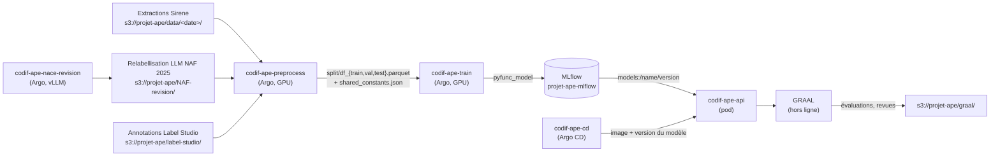

# codif-ape

Espace de travail du projet de codification automatique de l'APE (NAF / NACE) à l'Insee.

Ce dépôt regroupe tous les dépôts du projet en sous-modules, chacun sur sa branche `main`. Il ne sert pas à publier des versions. Ce qui compte, c'est la carte ci-dessous : qui produit quoi, où sont les données, et qui déploie quoi.

Les pointeurs des sous-modules se mettent à jour automatiquement. Chaque nuit à 3 h UTC, le workflow [`maj-sous-modules`](.github/workflows/maj-sous-modules.yml) les avance au dernier commit de `main` de chaque dépôt et pousse le résultat. On peut aussi le lancer à la main depuis l'onglet Actions. Il n'y a donc jamais besoin de commiter un changement de pointeur à la main. `.gitmodules` déclare d'ailleurs `ignore = all` pour que `git status` ne propose pas de le faire.

La note technique publique, en anglais et en français, est en ligne sur <https://inseefrlab.github.io/codif-ape-docs/>. Les présentations sont sur <https://inseefrlab.github.io/codif-ape-prez/>.

## Utilisation

```bash
git clone --recurse-submodules https://github.com/InseeFrLab/codif-ape.git
cd codif-ape

# Mettre tous les sous-modules à jour sur la tête de main
git submodule update --remote --recursive
```

Pour travailler dans un sous-module, il faut s'y placer et faire `git switch main` (ou une autre branche) avant de commiter. `update --remote` laisse en effet les sous-modules en HEAD détachée.

## Les dépôts

| Dépôt | Rôle | Produit | Consomme |
|---|---|---|---|
| [codif-ape-nace-revision](https://github.com/InseeFrLab/codif-ape-nace-revision) | Recodage NAF 2008 → NAF 2025 par LLM : correspondances univoques par règle, multivoques par LLM (stratégies CAG et RAG, vote majoritaire) | Jeu Sirene 4 en NAF 2025 (`NAF-revision/workflow_relabel/…/sirene4_nace2025.parquet`) | Extractions Sirene, table de passage, notices, annotations NAF 2025 |
| [codif-ape-preprocess](https://github.com/InseeFrLab/codif-ape-preprocess) | Nettoyage des labels par un moteur de règles métier (regex, fuzzy, similarité sémantique), avec un journal d'audit ; découpage train/val/test | Jeux nettoyés, splits, journaux de modifications, `shared_constants.json` | Extractions Sirene, données NAF 2025 relabellisées par LLM, tables de référence |
| [codif-ape-train](https://github.com/InseeFrLab/codif-ape-train) | Entraînement (torchTextClassifiers, Lightning, Hydra), évaluation, packaging en MLflow `pyfunc` | Runs et modèles MLflow | Splits produits par preprocess, `shared_constants.json`, `mappings.json` |
| [codif-ape-api](https://github.com/InseeFrLab/codif-ape-api) | API FastAPI : `POST /predict/` (top-k, indice de confiance, identifiant du modèle) | Image Docker `thomasfaria/codification-ape-api` | Modèle MLflow (`MLFLOW_MODEL_NAME` / `MLFLOW_MODEL_VERSION`) |
| [codif-ape-cd](https://github.com/InseeFrLab/codif-ape-cd) | Manifestes Kubernetes et Applications Argo CD (GitOps) | État déployé du namespace `projet-ape` sur le SSP Cloud | Images Docker, noms et versions de modèles |
| [GRAAL](https://github.com/InseeFrLab/GRAAL) | Agents LLM sur le graphe de la nomenclature (Neo4j) : Navigator, Agentic RAG, MatchVerifier, Code2Text ; applications de revue | Évaluations et revues humaines sur S3 ; image de l'application de revue | Notices, splits, API de prod (baseline et codes candidats) |
| [codif-ape-docs](https://github.com/InseeFrLab/codif-ape-docs) | Note technique publique (site Quarto bilingue) | Site GitHub Pages | — |

Dépôts liés, hors de cet espace de travail :

- [torchTextClassifiers](https://github.com/InseeFrLab/torchTextClassifiers) (TTC) : bibliothèque PyTorch de classification de texte avec variables catégorielles, publiée sur PyPI sous le nom `torchtextclassifiers`. train et api en dépendent (installation depuis git).
- [codif-ape-prez](https://github.com/InseeFrLab/codif-ape-prez) : présentations et articles. Sous-module de codif-ape-docs.
- `codif-ape-annotation` : scripts Label Studio appelés par le cronjob `etl-label-studio`.

## Flux de données



Les dépôts ne s'importent pas entre eux : ils communiquent par artefacts, selon trois contrats.

1. **preprocess → train** : `s3://projet-ape/data/shared_constants.json`.
   - Pour chaque révision (`NAF2008`, `NAF2025`), il contient la liste des dossiers de données ; train prend le dernier.
   - Il contient aussi les listes de variables (`TEXT_FEATURE`, `TEXTUAL_FEATURES`, `CATEGORICAL_FEATURES`), `COL_RENAMING` et `URL_MAPPINGS`.
   - preprocess y ajoute son dossier de sortie à chaque exécution.
2. **train → api** : un modèle MLflow `pyfunc` autoportant.
   - Il embarque le modèle TTC, la config Hydra, le code `src/api_wrapper` (formulaire Pydantic, mise en forme de la réponse) et les stopwords nltk, ce qui permet de le charger hors ligne.
   - Le contrat d'entrée et de sortie est défini dans `codif-ape-train/src/api_wrapper/models/`. Toute modification doit être répercutée dans codif-ape-api.
3. **cd → cluster** : l'image et le couple `MLFLOW_MODEL_NAME` / `MLFLOW_MODEL_VERSION` sont écrits dans `codif-ape-cd/<service>/deployment.yaml`.

## Où sont les données

Les données sont dans le bucket `projet-ape` du MinIO du SSP Cloud (`https://minio.lab.sspcloud.fr`).

| Chemin | Contenu | Écrit par | Lu par |
|---|---|---|---|
| `data/<JJMMAAAA>/naf2008/raw.parquet` | Extraction brute en NAF 2008 | extraction | preprocess |
| `data/<JJMMAAAA>/naf2025/raw_reprise.parquet` | Reprises manuelles en NAF 2025 | extraction | preprocess |
| `data/<JJMMAAAA>/naf2025/concat_synthetic_reprise.parquet` | Relabellisation LLM + reprises | preprocess (`concat_parquets`) | preprocess |
| `data/<JJMMAAAA>/{naf2008,naf2025}/raw_cleansed.parquet` | Données après application des règles | preprocess (`label_cleaning`) | preprocess |
| `data/<JJMMAAAA>/{rev}/artifacts/data_cleaning/` | Journaux de modifications (`_update`, `_augment`, `_delete`) | preprocess | audit |
| `data/<JJMMAAAA>/{rev}/split/df_{train,val,test}.parquet` | Splits d'entraînement | preprocess | train, GRAAL |
| `data/<JJMMAAAA>/{rev}/tokenizers/` | Tokenizer entraîné (WordPiece) | train | train |
| `data/shared_constants.json` | Contrat entre preprocess et train | preprocess | train |
| `data/mappings.json`, `data/cj.json` | Encodages des variables catégorielles, codes de catégorie juridique | — | train, preprocess |
| `data/naf{2008,2025}_extended.parquet` | Nomenclatures (codes, libellés, niveaux) | — | train, preprocess |
| `NAF-revision/` | Table de passage NAF 2008 → 2025, extractions, relabellisation LLM (`workflow_relabel/`) | codif-ape-nace-revision | preprocess, etl-sampling |
| `label-studio/annotation-campaign-2024/` | Campagnes d'annotation NAF 2008 et rev-NAF2025 (files d'attente, annotations, jeux prétraités) | etl-sampling, etl-label-studio, etl-monitoring | preprocess, évaluation |
| `notices/` | Notes explicatives NAF 2025, NACE 2.1, COICOP | — | GRAAL |
| `graal/data/eval/` | Évaluations du MatchVerifier et revues humaines | GRAAL | application de revue |
| `log_files/` | Logs de l'API | etl-monitoring | dashboard |

Le dossier `<JJMMAAAA>` est la date de l'extraction : le plus récent est `25062026`. Le dossier courant est celui que donne `shared_constants.json`.

**MLflow** : <https://projet-ape-mlflow.user.lab.sspcloud.fr>.

- Expériences : `torch_naf2008` et `torch_naf2025` (workflow Argo de train).
- Modèles enregistrés :
  - `FastText-pytorch` (NAF 2008) et `FastText-pytorch-2025` (NAF 2025) ;
  - anciens modèles : `FastText-APE`, `FastText-APE-nace2025`, `FastText-meta-rev2`.
- train n'enregistre pas les modèles dans le registry : l'enregistrement se fait à la main.

## Qui exécute et qui déploie quoi

| Quoi | Comment | Où |
|---|---|---|
| Prétraitement | Workflow Argo `codif-ape-preprocess/argo-workflows/preprocess.yaml` (GPU, NAF 2008 et 2025 en parallèle) | SSP Cloud |
| Entraînement | Workflow Argo `codif-ape-train/argo-workflows/train-workflow-gpu.yaml` (GPU, NAF 2008 et 2025 en parallèle) | SSP Cloud |
| Image de l'API | GitHub Actions `codif-ape-api/.github/workflows/build-image.yaml`, poussée sur Docker Hub (`latest`, branche, tags) | Docker Hub |
| Image de l'application de revue GRAAL | GitHub Actions `GRAAL/.github/workflows/docker.yml` | Docker Hub |
| Documentation | GitHub Actions vers GitHub Pages (codif-ape-docs, codif-ape-prez, GRAAL, torchTextClassifiers) | github.io |
| Déploiement | Argo CD synchronise chaque dossier de codif-ape-cd (sync auto, self-heal) dans le namespace `projet-ape` | SSP Cloud |
| Production Sirene | Hors de ces dépôts : le modèle qualifié est promu sur l'infrastructure interne de l'Insee | Insee |

Services déclarés dans codif-ape-cd :

| Dossier | Service | URL |
|---|---|---|
| `api-pytorch` | API PyTorch NAF 2008 et NAF 2025 | `codification-ape2008-pytorch.lab.sspcloud.fr`, `codification-ape2025-pytorch.lab.sspcloud.fr` |
| `api-prod` | API historique (fastText) | `codification-ape.lab.sspcloud.fr` |
| `api-dev` | API de développement NAF 2025 | `codification-ape-dev.lab.sspcloud.fr` |
| `api-meta-rev2` | API fastText NAF 2025 | `codification-meta-rev2-dev.lab.sspcloud.fr` |
| `api-rag`, `ui-rag` | API et interface Streamlit du prototype graph-RAG | `codification-ape-graph-rag-{api,ui}.lab.sspcloud.fr` |
| `graal-match-verifier-review` | Application de revue du MatchVerifier | `graal-match-verifier-review.lab.sspcloud.fr` |
| `dashboard` | Dashboard de suivi (redémarré chaque jour à 8 h) | `dashboard-ape.lab.sspcloud.fr` |
| `etl-sampling` | CronJob : tirage d'échantillons à annoter | — |
| `etl-label-studio` | CronJob (toutes les 30 min) : alimentation de Label Studio | — |
| `etl-monitoring` | CronJob (chaque jour à 3 h) : conversion des annotations et des logs | — |

## Points d'attention

Constats faits en lisant le code (octobre 2026) :

- Les cronjobs `etl-*` téléchargent au démarrage des scripts et un `requirements.txt` depuis `codif-ape-api/main/utils/`. Le `requirements.txt` n'existe plus depuis le passage à uv : vérifier que ces jobs tournent encore.
- `codif-ape-cd/argocd-templates/` contient encore une Application `api-test-pytorch-wrapper` dont le dossier a été supprimé.
- Le score de confiance servi (`IC = p1 − p2`, dans `api_wrapper`) diffère de celui de la courbe d'évaluation de train (`p1 − Σ p2..p5`).
- Aucun manifeste de codif-ape-cd ne déploie encore l'API migrée vers MLflow 3 et TTC v2 (juillet 2026).
